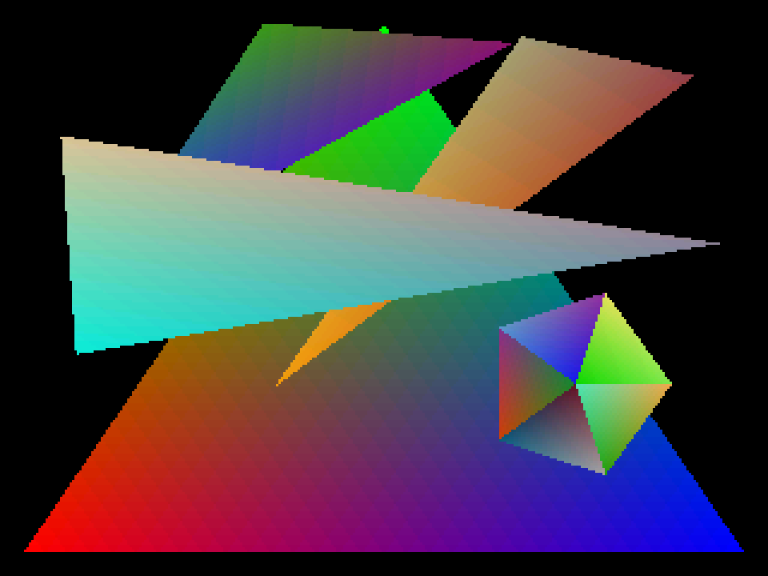
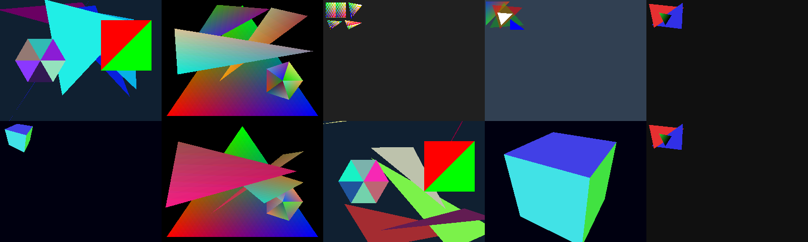
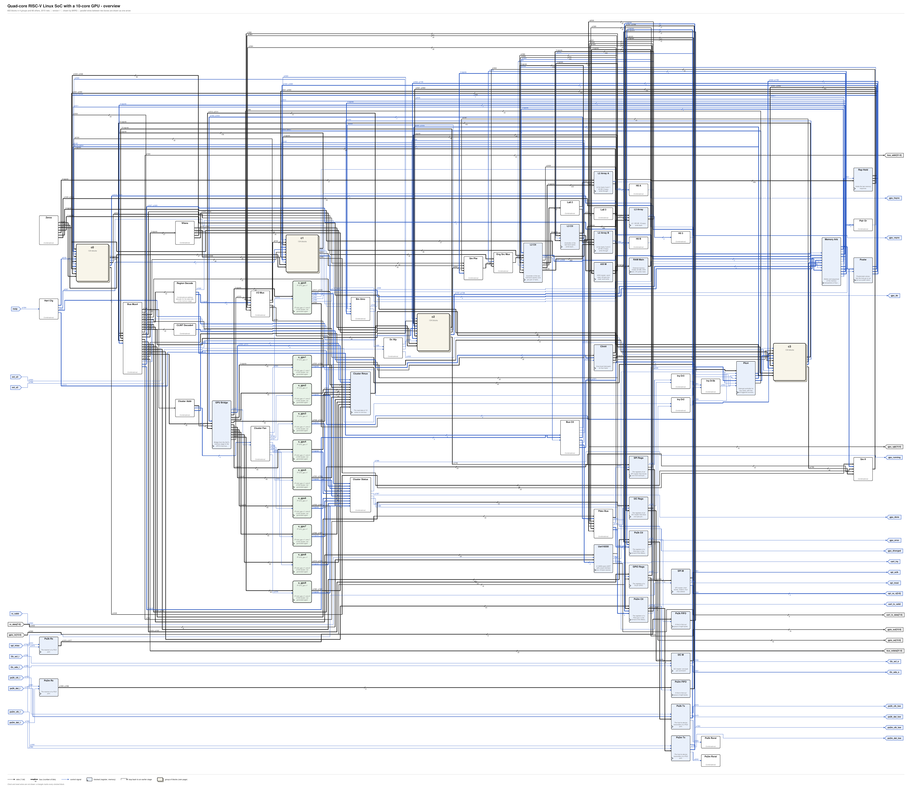
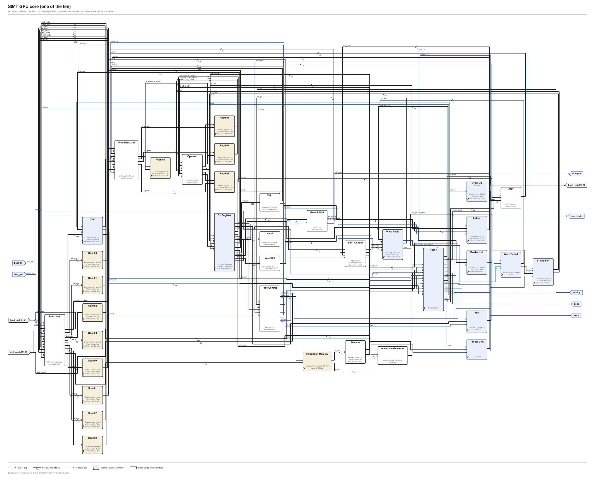
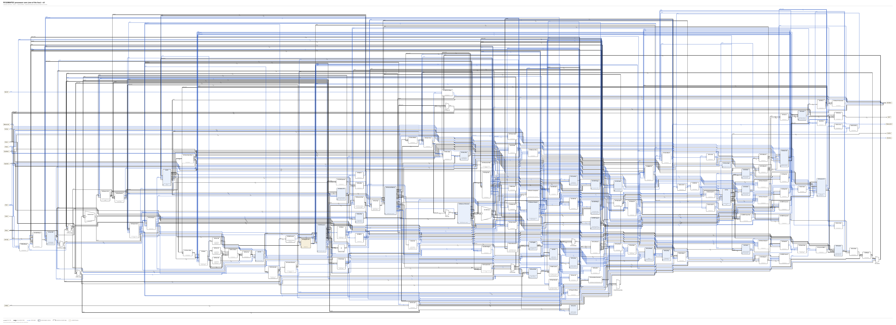

# BARG-SoC: a Linux-capable quad-core RISC-V SoC with a 10-core SIMT graphics GPU, as Verilog, running on an FPGA

A complete system-on-chip, all of it Verilog, built with the **BARG** framework (UGRA, IIT (BHU)): four RISC-V cores with an MMU and floating point that boot **Linux 6.6**, a three-level cache hierarchy over AXI4, the usual peripherals, and a **ten-core SIMT GPU with fixed-function graphics** that draws triangles, textures and depth-tested scenes into a 320 x 240 framebuffer.

It has been simulated end to end (Verilator) and it runs on a **Xilinx ZCU104** board: Linux boots to a shell on the FPGA, and the GPU on the FPGA draws a scene that is **pixel-identical to the reference model** (0 of 76,800 pixels differ).

<p align="center">
  
</p>
<p align="center"><em>A frame drawn by the GPU running on the ZCU104 FPGA (Linux userspace program, scene "gouraud", read back from video memory and sent to the PC over the UART). It matches the golden frame model in every pixel. 320 x 240, shown at 3x.</em></p>

---

## Contents

1. [What is in the SoC](#1-what-is-in-the-soc)
2. [The graphics renders](#2-the-graphics-renders)
3. [Block diagrams (high-resolution vector PDFs)](#3-block-diagrams-high-resolution-vector-pdfs)
4. [How it was made](#4-how-it-was-made)
5. [What was verified](#5-what-was-verified)
6. [Repository layout](#6-repository-layout)
7. [Simulate the SoC](#7-simulate-the-soc)
8. [The FPGA builds](#8-the-fpga-builds)
9. [The GPU in more detail](#9-the-gpu-in-more-detail)
10. [Status and roadmap](#10-status-and-roadmap)
11. [Licence and credits](#11-licence-and-credits)

---

## 1. What is in the SoC

| Part | What it is |
|---|---|
| **CPU** | 4 harts, each **RV32IMAFDC** with the **Sv32** MMU, supervisor and machine modes, 16 PMP entries, a gshare branch predictor, 32-entry TLBs, atomics (LR/SC, AMO), and a floating-point unit (single and double) per core. A hart that executes `WFI` stops its clock until an enabled interrupt is pending. |
| **Caches** | Private split L1 per hart (32 KB instruction, 2-way; 16 KB data, 2-way, write-through), one L2 per pair of harts (32 KB, 8-way), one L3 (128 KB, 16-way, write-back) with a directory that keeps the harts' data caches coherent. Lines are 32 bytes. |
| **Memory** | 64 MB RAM at `0x8000_0000` behind an AXI4 master (the testbench has a 30-cycle memory model; on the FPGA the AXI master goes to the board's DDR). |
| **Interrupts and timers** | CLINT (software and timer interrupts, `mtime` prescaled in hardware), PLIC with machine and supervisor contexts for every hart. |
| **Peripherals** | 8250-compatible UART, GPIO, SPI master, I2C master, and PS/2 keyboard and mouse ports (Altera UP register model). |
| **GPU** | **10 SIMT cores**, each with 4 warps of 4 lanes running RV32IM threads, divergence stack, barriers, shared memory, warp vote and shuffle, an INT8 tensor unit, and a **fixed-function graphics pipeline**: triangle rasteriser, texture unit, raster-output unit with alpha blending and a depth buffer, a 320 x 240 RGB565 video memory and a display scan-out. Linux user programs drive it through `/dev/mem`. |
| **Software** | OpenSBI 1.5 and Linux 6.6.63 with a BusyBox initramfs; a framebuffer driver (`barg_fb`) for the GPU's video memory; a `gpu` program that renders a scene on the GPU and checks the frame. |

## 2. The graphics renders

### The GPU on the FPGA

The picture at the top was drawn on the real chip. A user program on the FPGA's Linux (`linux/sw/prog/gpu.c`) loads the triangle program and the scene into the GPU, starts it, waits for `STATUS = done`, reads the finished frame back, checks its checksum against the model and saves it. The frame then travelled to the PC compressed with `gzip` over the UART. The frame matches the golden model in all 76,800 pixels.

### Ten cores, ten scenes, simulated on the generated Verilog

Each of the ten GPU cores renders a different scene at the same time, on the SoC's generated Verilog (Verilator). Every pixel of every frame matches the frame model. The whole run takes 2,868,953 cycles.

<p align="center"></p>

| Core | Scene (name and seed) | What it shows |
|---|---|---|
| 0 | `flat` (7) | flat-shaded triangles |
| 1 | `gouraud` (7) | per-vertex colour interpolation with depth ordering |
| 2 | `tex_small` (7) | texture-mapped triangles |
| 3 | `blend_small` (7) | alpha blending (source-over) |
| 4 | `depth_small` (7) | depth-buffer test (`ztest`) |
| 5 | `cube_small` (7) | a small lit cube |
| 6 | `gouraud` (3) | Gouraud shading, other seed |
| 7 | `flat` (3) | flat shading, other seed |
| 8 | `cube` (7) | a larger cube |
| 9 | `depth_small` (3) | depth test, other seed |

The individual frames are in [`renders/cluster-sim/`](renders/cluster-sim/); the scene definitions are in [`gpu/gfx/scenes.py`](gpu/gfx/scenes.py), and `gpu-cluster/gfx_tests.py` regenerates them.

## 3. Block diagrams (high-resolution vector PDFs)

The block diagrams are drawn by BARG's diagram export, in the style of a computer-architecture textbook: boxes with the block's name, a clock triangle on every register and memory, trapezoid multiplexers, buses with the number of bits, control signals in blue, and loops back to an earlier stage over the top. They are **vector PDFs**: zoom in as far as you like, or print them on any paper size.

| Diagram | PDF | What it shows |
|---|---|---|
| **The whole SoC** | [`diagrams/soc-overview.pdf`](diagrams/soc-overview.pdf) | the four processors (each one box of 134 blocks), all ten GPU cores (each one box under the name it was placed with, `u_gpu0` to `u_gpu9`), the shared memory system, interrupt controllers, bus and peripherals |
| **One CPU core** | [`diagrams/cpu-core.pdf`](diagrams/cpu-core.pdf) | the 134 blocks inside one RV32IMAFDC processor: fetch, decode, execute, memory, writeback, TLBs, page-table walker, caches, FPU glue, PMP and CSRs; the blocks around it are the dashed tags at the edges |
| **One GPU core** | [`diagrams/gpu-core.pdf`](diagrams/gpu-core.pdf) | the 36 blocks of one SIMT GPU core: instruction memory, decoder, four-lane ALUs, register files, warp scheduler, divergence stack, tensor unit, load/store unit and the banked memories |

An overview of all pages (the SoC, then each of the four processors) is in [`diagrams/soc-all-pages.pdf`](diagrams/soc-all-pages.pdf).

[](diagrams/soc-overview.pdf)

*The whole SoC. Click for the vector PDF.*

[](diagrams/gpu-core.pdf)

*One GPU core. Click for the vector PDF.*

[](diagrams/cpu-core.pdf)

*One CPU core (134 blocks); open the PDF and zoom in to read it.*

The diagrams come from the design files in this repository (`soc/design-quad5-*.json` and `gpu/design.json`); BARG can draw any design the same way (<https://github.com/UGRA-IITBHU/BARG>, `docs/diagram-export.md`).

## 4. How it was made

The design was built with **BARG**, a framework that turns a block-level design description into verified Verilog:

* The SoC is a graph of about 600 **blocks** (cores' pipeline stages, TLB, cache controllers, FPU glue, GPU units, peripherals, interconnect). Each block has an exact written description.
* For every block a **hand-written Python golden model** exists. The golden model is never shown to the code generator.
* The Verilog of each block was **generated by language models and accepted only when it agreed with its golden model** on test vectors. A few well-understood blocks are **curated IP** written by hand (cache array, AXI4 master, DRAM model, FPU, UART, FIFO, SPI, I2C).
* The accepted blocks are wired exactly as the design graph says, flattened, and assembled into `top.v` and `blocks.v`. Those two files are in [`rtl/soc-full/`](rtl/soc-full/) and are everything the simulator needs.

The scripts that drive this flow need the BARG repository (<https://github.com/UGRA-IITBHU/BARG>); they are included here for reference. **The Verilog in `rtl/` is the finished output and needs nothing else.**

## 5. What was verified

All of it on the generated Verilog, in Verilator, unless it says FPGA:

| Check | Result |
|---|---|
| RISC-V ISA test suites (riscv-tests: integer, M, A, C, F, D) | 104 of 104 pass |
| Four harts walking page tables at the same time, atomics, LR/SC | pass |
| Software, timer and external (PLIC) interrupts | pass |
| A random mix of integer and floating-point instructions against the Python model | agrees |
| The six GPU compute kernels on ten cores | pass |
| Ten graphics scenes on ten cores, every pixel vs. the frame model | exact (2,868,953 cycles) |
| Four harts each driving a GPU core | pass |
| **Linux 6.6.63 with OpenSBI**, four CPUs up, BusyBox shell, GPU from userspace | boots and works |
| **FPGA (ZCU104):** Linux to a shell, `gpu` program on the real GPU | frame matches the model in 76,800 of 76,800 pixels |

## 6. Repository layout

| Folder | Contents |
|---|---|
| [`rtl/soc-full/`](rtl/soc-full/) | **The whole SoC as Verilog**: `top.v` (the wiring) and `blocks.v` (every block): 4 harts, the cache hierarchy, peripherals and 10 GPU cores. |
| [`rtl/soc-fpga-zcu104/`](rtl/soc-fpga-zcu104/) | The SoC as built for the ZCU104: external AXI4 master, small caches, one GPU core, the cores' clock gates as clock-enable buffers, the board wrapper `soc_zcu104.v`, UART and FIFO. |
| [`rtl/soc-fpga-vek280/`](rtl/soc-fpga-vek280/) | The same for the Versal VEK280 (4 GPU cores). |
| [`gpu/`](gpu/) | **The GPU**: `rtl/` (the core's 36 blocks), `gfx/` (graphics pipeline: Verilog, kernels, scenes), `golden/` and `model/` (the Python golden and reference models), `sw/` (kernels, host library), `ISA.md`. |
| [`gpu-cluster/`](gpu-cluster/) | Ten GPU cores on the SoC: the cluster builder and the tests that draw ten scenes. |
| [`gpu-soc/`](gpu-soc/) | GPU-in-SoC tests and the host/bus model. |
| [`soc/`](soc/) | The quad-core SoC builders (`build_quad5.py`), hand-written pieces, testbenches (`tests/`) and the final design description. |
| [`linux/`](linux/) | Boot Linux on the SoC: device trees (simulation and FPGA), kernel config, init program, `gpu` and `cursor` programs, firmware build scripts, the UART console testbench, the Python core model, and the browser GUI (`gui/`). |
| [`fpga/`](fpga/) | ZCU104 and VEK280 flows: export script, Vivado Tcl, pin constraints, the loader, resource and timing reports; `fpga/zcu104/hdmi/` has the HDMI output work in progress. |
| [`ip/`](ip/) | The curated IP library (UART, FIFO, cache array, AXI4 master, FPU, SPI, I2C, RAM, DRAM model) with its tests. |
| [`diagrams/`](diagrams/) | The block diagrams as high-resolution vector PDFs (the whole SoC, one CPU core, one GPU core) with preview images. |
| [`renders/`](renders/) | The images in this README. |

## 7. Simulate the SoC

You need Verilator 5 and a RISC-V firmware image. Compile the whole SoC with the console testbench:

```bash
verilator --binary --timing -Wno-fatal -Wno-lint -Wno-style -Wno-WIDTH -Wno-UNOPTFLAT -Wno-MULTIDRIVEN -O3 -j 12 \
  --top-module console_tb --Mdir obj -o Vsoc -Ilinux/console -Isoc/tests \
  -DGPU -DHIER -DMEMSYS -DPERIPH -DPS2 \
  rtl/soc-full/top.v rtl/soc-full/blocks.v linux/console/console_tb.v linux/console/host.cpp
```

Build the firmware (OpenSBI 1.5.1 + Linux 6.6.63 + BusyBox) with [`linux/sw/build_busybox.sh`](linux/sw/build_busybox.sh) (it needs the Linux and OpenSBI source trees and the Bootlin riscv32 musl toolchain in one work folder; see the comments at the top of the script). That gives `fw_payload.bin`, which is linked for `0x8000_0000`. Convert it and run:

```bash
python3 linux/tools/bin2hex.py fw_payload.bin fw.hex
./obj/Vsoc +HEX=fw.hex +LIMIT=400000000      # the shell prompt appears after about 335 million simulated cycles
```

The UART is the terminal (type into it; it has a one-byte receive register, so typing is slow). Type `gpu` in the shell to render a scene on the GPU and check it.

Smaller runs: the ISA tests and the GPU tests are in `soc/tests/`, `gpu/` and `gpu-cluster/` (Python drivers around Verilator).

## 8. The FPGA builds

### ZCU104 (Zynq UltraScale+ XCZU7EV): works, Linux boots

| | |
|---|---|
| Design | 4 harts, small caches (2 KB L1 instruction and data, 512 B L2, 1 KB L3), **1 GPU core**, 64 MB RAM in the board's DDR |
| Clock | **20 MHz** |
| Utilisation | 148,105 LUTs (64.3%), 70,880 registers (15.4%), 133.5 block RAMs (42.8%), 391 DSPs (22.6%) |
| Timing | met: setup slack +11.7 ns, hold +0.010 ns, no failing endpoints |
| Boot | JTAG loads the bitstream and the 7.8 MB Linux image into DDR; the shell prompt (`barg#`) appears about 80 seconds after release |
| GPU | the `gpu` program renders the "gouraud" scene on the FPGA; checksum equals the model's |

Flow (needs Vivado 2025.2; the ZCU104 is supported by the free ML Standard edition):

```bash
python3 fpga/zcu104/export.py --gpu-cores 1          # writes the Verilog (also in rtl/soc-fpga-zcu104/)
cd fpga/zcu104
vivado -mode batch -source build_bd.tcl              # block design: PS + SoC
vivado -mode batch -source build_bit.tcl             # synthesis, implementation, bitstream
xsdb load.tcl build/out/soc.bit fw_payload.bin       # program, train DDR, load Linux, start the SoC
```

Set boot switch SW6 to all ON (JTAG). The console is the PL UART on the board's USB-serial bridge (115200 8N1). A small browser GUI (`linux/gui/server.py --serial /dev/ttyUSB3`) shows the console and can send a **screenshot of the framebuffer** or of the GPU's frame to the PC; both travel compressed with `gzip`, which keeps a frame at a few kilobytes over the slow UART.

Notes for reproducing it:

* The FPGA build uses small caches (2 KB L1 instruction and data, 512 B L2, 1 KB L3); the simulation netlist (`rtl/soc-full/`) uses the full sizes.
* Boot the FPGA with the device tree [`linux/sw/barg-fpga-slowtick.dts`](linux/sw/barg-fpga-slowtick.dts) (timebase 12.5 MHz).
* Reload the board with the full `load.tcl` each time (PS, DDR, chip, image).

### Versal AI Edge VEK280 (VE2802): builds

The same SoC with 4 GPU cores builds for the VEK280 (Vivado 2025.2 Enterprise with Versal support and a VE2802 licence): 303,498 LUTs (58.3%), 87,218 registers, 50 block RAMs, 56 UltraRAMs, 20 MHz with setup slack +4.1 ns and hold +0.010 ns. The programming image (`.pdi`) is generated by `fpga/vek280/build_bit.tcl`; the design uses CIPS and the NoC with the board's LPDDR4. It has not been run on the board yet.

## 9. The GPU in more detail

The GPU core is a small GPU built the way commercial ones are: warps of threads in lockstep, a warp scheduler that hides latency by switching warps, a divergence stack, barriers, banked shared memory, warp vote and shuffle, and a 4 x 4 x 4 INT8 tensor unit. Every thread runs RV32IM, so kernels are ordinary C compiled with the stock RISC-V GCC. The graphics extension adds seven instructions (`gfx.cfg`, `rast`, `rast.cov`, `rast.edge`, `tex`, `pix`, `ztest`) for the rasteriser, the texture unit and the raster-output unit.

* Instruction set: [`gpu/ISA.md`](gpu/ISA.md)
* Block diagram of one GPU core: [`diagrams/gpu-core.pdf`](diagrams/gpu-core.pdf)

## 10. Status and roadmap

Working today: the full SoC in simulation (Linux, GPU, ten scenes), the ZCU104 build with Linux and the GPU on the FPGA, and a VEK280 build that completes with timing met.

Next:

* **Bigger caches on the FPGA** by redesigning the cache arrays as synchronous-read block RAM and UltraRAM, so the FPGA can match the simulation's cache sizes and run faster.
* **HDMI output** of the GPU's video memory (work in progress in [`fpga/zcu104/hdmi/`](fpga/zcu104/hdmi/): a TMDS encoder, a 1280 x 720 timing generator and the transceiver setup for the ZCU104's HDMI connector).
* Running the VEK280 build on the board.
* A faster clock and more GPU cores on the larger device.

## 11. Licence and credits

BSD 3-Clause, see [`LICENSE`](LICENSE). Copyright (c) 2026 UGRA, IIT (BHU).

Built with the **BARG** framework (<https://github.com/UGRA-IITBHU/BARG>). The firmware sources (Linux, OpenSBI, BusyBox) are not included; build them from their upstream releases with the scripts in `linux/sw/`.
